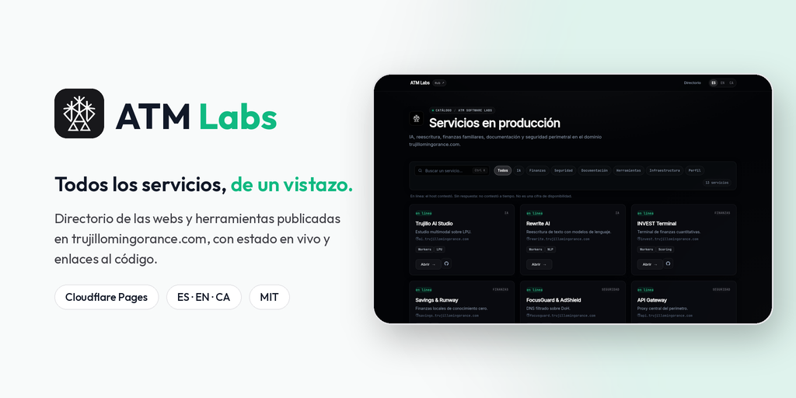
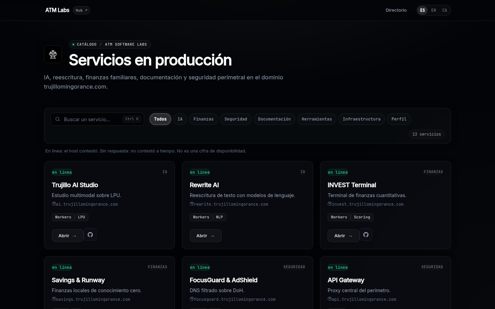
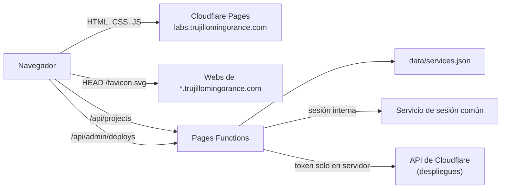

<p align="center">
  
</p>

<p align="center">
  <strong>Directorio de las webs y herramientas publicadas en trujillomingorance.com, con estado en vivo y enlaces al código.</strong><br/>
  <em>Service directory for everything published under trujillomingorance.com (Spanish, English and Catalan).</em>
</p>

<p align="center">
  <a href="https://labs.trujillomingorance.com"><b>labs.trujillomingorance.com</b></a> ·
  <a href="https://labs.trujillomingorance.com/en/">English</a> ·
  <a href="https://labs.trujillomingorance.com/ca/">Català</a> ·
  <a href="LICENSE">Licencia MIT</a>
</p>

<p align="center">
  
  
  
  
</p>

---

## Capturas

<p align="center"></p>

## Funciones

- **Catálogo de servicios** con filtros por categoría (IA, finanzas, seguridad, documentación, herramientas, perfil y plataforma) y búsqueda.
- **Estado en vivo:** cada servicio se comprueba desde tu navegador con un `HEAD` ligero a un archivo estático; el resultado se guarda 5 minutos para no repetir peticiones.
- **Enlaces al código** solo cuando el repositorio es público y su configuración de despliegue confirma el dominio.
- **Tres idiomas:** español en `/`, inglés en `/en/` y catalán en `/ca/`. El selector recuerda tu elección (`atm_lang_choice`).
- **Marca común:** tokens, logotipo e iconos copiados de [trujillomingorance.com/brand](https://trujillomingorance.com/brand/).
- **Panel interno:** si entras con una cuenta interna de Microsoft Entra ID, aparece el enlace «Panel interno» y el panel central puede leer el último despliegue de cada proyecto.

## Stack

| Capa | Tecnología |
|---|---|
| Frontend | HTML generado por `scripts/build-pages.js`, CSS y JavaScript sin framework |
| Hosting | **Cloudflare Pages** (estáticos + cabeceras en `_headers`) |
| API | **Pages Functions** solo en `/api/*` (`_routes.json`) |
| Datos | `data/services.json` (catálogo y repositorios confirmados) |
| CI | GitHub Actions: `npm test` en cada push y PR |

## Arquitectura



| Ruta | Qué hace |
|---|---|
| `/`, `/en/`, `/ca/` | Directorio en cada idioma |
| `GET /api/projects` | Catálogo publicado |
| `/api/auth/*` | Proxy de sesión hacia `ai.trujillomingorance.com` |
| `GET /api/admin/deploys` | Último despliegue de cada proyecto (solo sesión interna) |

## Seguridad

- **Cabeceras:** CSP estricta (scripts propios y la analítica de Cloudflare), HSTS con preload, `X-Frame-Options: DENY`, `nosniff`, Referrer-Policy y Permissions-Policy.
- **Functions solo en `/api/*`:** las páginas y los 404 (incluidos los de escáneres que buscan `.env` o `phpinfo`) se sirven como estáticos, sin ejecutar código.
- **Panel interno:** el token de Cloudflare nunca sale del servidor y `/api/admin/*` comprueba la sesión en cada petición.

## Desarrollo local

Requisitos: **Node.js ≥ 20**.

```bash
git clone https://github.com/ATM-Software-Labs/atm-labs-hub.git && cd atm-labs-hub
npm run build                          # regenera public/index.html, en/ y ca/
npm test                               # build + node --test
npx wrangler pages dev public          # http://localhost:8788
```

| Comando | Qué hace |
|---|---|
| `npm run build` | Genera las páginas de cada idioma desde `scripts/build-pages.js` |
| `npm test` | Build y pruebas (`test/*.js`, `test/*.mjs`) |
| `npm run deploy` | `wrangler pages deploy public --project-name=atm-labs-hub` |

## Despliegue

El proyecto de Cloudflare Pages `atm-labs-hub` está conectado a GitHub: cada push a `main` publica en `labs.trujillomingorance.com`.

### Variables (solo nombres)

| Nombre | Tipo | Uso |
|---|---|---|
| `CF_ACCOUNT_ID` | variable | Cuenta de Cloudflare para leer despliegues |
| `CF_API_TOKEN` | secreto | Token para leer los despliegues en `/api/admin/deploys` (dale solo permisos de lectura) |
| `ENVIRONMENT` | variable | `production` |

## Estructura

```
public/               index.html (es), en/, ca/, 404.html, _headers, _routes.json, css/, js/, assets/
functions/            _middleware.js, api/projects.js, api/auth/, api/admin/deploys.js, lib/internal.js
data/services.json    catálogo y repositorios confirmados
scripts/              build-pages.js, atm-net.cjs (pie común)
test/                 pruebas con node --test
docs/                 banner y capturas
```

## Licencia

[MIT](LICENSE) © 2026 Alberto Trujillo Mingorance. Fuentes Inter y JetBrains Mono bajo SIL OFL 1.1.

<p align="center"><sub>© 2026 ATM Software Labs · <a href="https://trujillomingorance.com">trujillomingorance.com</a></sub></p>
